<!--
  Profile assets are generated by .github/workflows/profile.yml (scripts/generate.mjs)
  and published to the `output` branch every 6 hours — no third-party image services.
-->

  
  
  
  
  

### ⚡ Now

- 🏢 **Head of Engineering @ Porteria®** — leading the team that builds and ships the platform.
- 🚩 Maintaining [**pennants**](https://github.com/D3vaya/pennants), an open-source library with 271 country flags in every shape.
- 🧪 Exploring Elixir / Phoenix LiveView, Go and Astro on the side.
- ⚽ Football, 📚 manga and games when the laptop is closed.

### 🗓️ This season

### 🚀 Featured work

<table>
  <tr>
    <td width="50%" valign="top">
      <h3>🚩 <a href="https://github.com/D3vaya/pennants">pennants</a></h3>
      
Every flag, every shape, one API. <b>271 country flags</b> as pennants, rectangles, squares and circles — SVG, PNG, CSS, tree-shakable ESM, React and a Web Component. ~1.2 kB gzip per flag.

      
      
    </td>
    <td width="50%" valign="top">
      <h3>🚦 <a href="https://github.com/D3vaya/jam">JAM</a></h3>
      
Isometric web game where you <b>orchestrate the traffic lights</b> of a living city. A prototype built to answer one question: <i>is controlling flow fun?</i>

      
    </td>
  </tr>
  <tr>
    <td width="50%" valign="top">
      <h3>🏋️ <a href="https://github.com/D3vaya/adelgazapix">Adelgazapix</a></h3>
      
Your PNGs go in fat and come out fit. Drag &amp; drop, process with <b>Sharp</b> on the server, download optimized WebP — one by one or as a ZIP.

      
    </td>
    <td width="50%" valign="top">
      <h3>🔌 <a href="https://github.com/D3vaya/CPU-8bits">CPU-8bits</a></h3>
      
From transistors to an operating system: a guide to <b>building an 8-bit CPU from scratch in TypeScript</b>.

      
    </td>
  </tr>
  <tr>
    <td colspan="2" valign="top">
      <b>💜 Elixir lab</b> —
      <a href="https://github.com/D3vaya/chess">♟️ chess</a> ·
      <a href="https://github.com/D3vaya/tetris">🧱 tetris</a> ·
      <a href="https://github.com/D3vaya/elevator_simulator">🛗 elevator_simulator</a> ·
      <a href="https://github.com/D3vaya/mastery">🎓 mastery</a>
    </td>
  </tr>
</table>

### 🛠️ Toolbox

   
  

### 🐍 The snake eats my commits

<picture>
  <source media="(prefers-color-scheme: dark)" srcset="https://raw.githubusercontent.com/D3vaya/D3vaya/output/github-snake-dark.svg" />
  <source media="(prefers-color-scheme: light)" srcset="https://raw.githubusercontent.com/D3vaya/D3vaya/output/github-snake.svg" />
  
</picture>

Intentando ser un buen programador ლ(▀̿̿Ĺ̯̿̿▀̿ლ) · assets self-generated by <a href=".github/workflows/profile.yml">a workflow</a> in this repo

